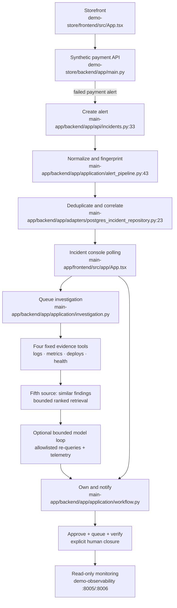

# Demo Commerce Flow

## Side effects

- Payment details are handled only by the store API and are not placed in alert payloads.
- Alert intake writes the existing alert, incident, and timeline records.
- Investigation uses the existing durable worker path.
- The four-tool fan-out and deterministic finding run before optional model enrichment; no configured model means no additional loop work.
- Similar-history retrieval, model requests, and telemetry are evidence/readout paths and cannot authorize actions.
- Paging writes delivery attempts and sends a local captured email.
- Approval queues once, verification confirms observed state, and incident closure remains an operator decision.
