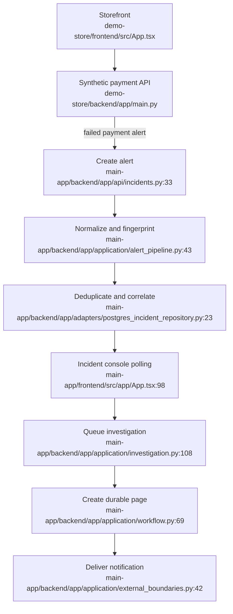

# Demo Commerce Flow

## Side effects

- Payment details are handled only by the store API and are not placed in alert payloads.
- Alert intake writes the existing alert, incident, and timeline records.
- Investigation uses the existing durable worker path.
- Paging writes delivery attempts and sends a local captured email.
