# Unified Proposal

Use one flow from synthetic commerce failure to operator response:

1. The separate store frontend owns catalog, cart, and checkout interaction.
2. The separate store backend owns pricing and synthetic payment decisions.
3. A failed attempt constructs a minimal operational alert without payment credentials.
4. The existing alert endpoint owns validation, deduplication, correlation, and persistence.
5. The existing assistant owns investigation, paging, and safe action decisions, while its notification boundary delivers a captured local email for demonstration.

```mermaid
flowchart LR
    A["Catalog and checkout<br/>demo-store/frontend/src/App.tsx"]
    S["Store payment API<br/>demo-store/backend/app/main.py"]
    B["Canonical alert intake<br/>main-app/backend/app/api/incidents.py:33"]
    C["Existing incident pipeline<br/>main-app/backend/app/application/alert_pipeline.py:18"]
    D["Existing investigation worker<br/>main-app/backend/app/application/investigation.py:108"]
    E["Existing paging workflow<br/>main-app/backend/app/application/workflow.py:69"]
    F["Captured email<br/>main-app/backend/app/application/external_boundaries.py:42"]
    A --> S --> B --> C --> D --> E --> F
```

No automatic remediation or automatic responder decision is introduced.
