# Unified Proposal

Use one bounded flow from scenario creation or synthetic commerce failure to human-owned response:

1. The separate store frontend owns catalog, cart, checkout interaction, and customer-facing scenario journeys.
2. The separate store backend owns pricing, synthetic payment decisions, and bounded failure alerts.
3. `scripts/add-scenario.sh` validates data-defined scenarios, registers them through the simulator API, triggers one alert, and prints the incident id.
4. The existing alert endpoint owns validation, deduplication, correlation, and persistence.
5. The worker runs the four fixed evidence tools, derives the deterministic finding, then retrieves similar completed findings as a fifth evidence source.
6. If a model gateway is configured, it may request only allowlisted evidence re-queries within bounded rounds, items, requests, and wall-clock time; without a model, the fixed path is unchanged.
7. Persisted investigation telemetry records source durations, retrieval latency, token estimates, and finite cost estimates.
8. The existing assistant owns paging, explicit ownership, approval-plus-queueing, execution, verification, and human closure decisions.
9. The separate observability demo derives read-only service snapshots and links back to the incident and remediation workflow.
10. HLD, LLD, and project records remain the authoritative architecture and decision sources; this folder is a navigation and handoff packet.

```mermaid
flowchart LR
    A["Store journeys<br/>demo-store/frontend/src/App.tsx"]
    S["Store API<br/>demo-store/backend/app/main.py"]
    O["Scenario onboarding<br/>scripts/add-scenario.sh"]
    B["Canonical alert intake<br/>main-app/backend/app/api/incidents.py"]
    C["Incident pipeline<br/>main-app/backend/app/application/alert_pipeline.py"]
    D["Worker investigation<br/>main-app/backend/app/application/investigation.py"]
    R["Similar findings + telemetry<br/>main-app/backend/app/application/retrieval.py"]
    E["Ownership and remediation<br/>main-app/backend/app/application/workflow.py"]
    F["Captured notification<br/>main-app/backend/app/application/external_boundaries.py"]
    M["Monitoring backlink<br/>demo-observability/frontend/src/App.tsx"]
    A --> S --> B --> C --> D --> R --> E --> F --> M
    O --> B
```

No automatic remediation, automatic responder decision, or external metric source is introduced. Deterministic findings remain authoritative for the category and action proposal.
