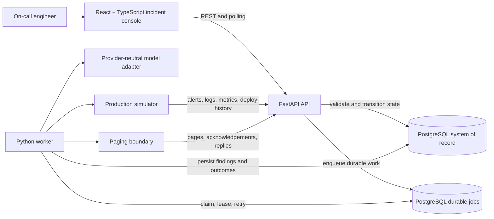

# System Architecture

This is the product's high-level system architecture. It defines the runtime boundaries, durable responsibilities, and relational tables required by the incident workflow. Detailed sequence flow, domain relationships, and UI structure are documented separately.

## 1. Runtime architecture

## 2. Responsibility boundaries

| Component | Owns | Does not own |
| --- | --- | --- |
| React + TypeScript UI | Incident list, incident detail, timeline rendering, human decision forms | State transitions, action execution, inferred completion |
| FastAPI API | Validation, authorization, idempotency, state transitions, read models, audit events | Long-running investigation or direct model execution |
| Python worker | Investigation, paging, action execution, verification, retries, leases | Browser presentation or unvalidated human intent |
| PostgreSQL | Incidents, evidence, decisions, jobs, actions, verification, audit history | External alert generation or model reasoning |
| Production simulator | Deterministic alerts, logs, metrics, deploy history, typed operational actions | Production credentials or arbitrary command execution |
| Model adapter | Structured findings and action recommendations from supplied evidence | Direct database writes or action execution |
| Paging boundary | Page delivery and responder inputs | Incident truth or action authorization |

## 3. Relational schema catalog

All tables use UUID primary keys unless stated otherwise. `created_at` and `updated_at` are UTC timestamps. Foreign keys are enforced by PostgreSQL. JSON fields contain validated objects rather than free-form executable instructions.

### 3.1 incidents

| Field | Type | Key / constraint | Purpose |
| --- | --- | --- | --- |
| id | uuid | PK | Stable incident identifier |
| fingerprint | text | UNIQUE | Correlation key for duplicate and related alerts |
| service | text | NOT NULL | Affected service |
| environment | text | NOT NULL | Simulated environment |
| severity | text | NOT NULL | Incident severity |
| status | text | NOT NULL | Lifecycle state |
| summary | text |  | Current human-readable condition |
| version | integer | NOT NULL | Optimistic concurrency version |
| opened_at | timestamptz | NOT NULL | First observed incident time |
| resolved_at | timestamptz |  | Resolution time |
| created_at | timestamptz | NOT NULL | Record creation time |
| updated_at | timestamptz | NOT NULL | Last record update time |

### 3.2 alerts

| Field | Type | Key / constraint | Purpose |
| --- | --- | --- | --- |
| id | uuid | PK | Alert identifier |
| incident_id | uuid | FK -> incidents.id, NOT NULL | Correlated incident |
| source_event_id | text | UNIQUE | Source idempotency key |
| fingerprint | text | NOT NULL | Alert correlation fingerprint |
| alert_type | text | NOT NULL | Alert category |
| payload | jsonb | NOT NULL | Original validated alert payload |
| source_time | timestamptz | NOT NULL | Time reported by source |
| received_at | timestamptz | NOT NULL | Time accepted by API |
| lifecycle | text | NOT NULL | Open, duplicate, late, or closed handling |

### 3.3 evidence

| Field | Type | Key / constraint | Purpose |
| --- | --- | --- | --- |
| id | uuid | PK | Evidence record identifier |
| incident_id | uuid | FK -> incidents.id, NOT NULL | Related incident |
| source_type | text | NOT NULL | Logs, metrics, deploys, or alert source |
| query | text | NOT NULL | Read-only simulator query |
| result | jsonb | NOT NULL | Returned evidence |
| availability | text | NOT NULL | Available, slow, unavailable, or partial |
| observed_at | timestamptz | NOT NULL | Evidence observation time |
| collected_at | timestamptz | NOT NULL | Collection time |

### 3.4 findings

| Field | Type | Key / constraint | Purpose |
| --- | --- | --- | --- |
| id | uuid | PK | Finding identifier |
| incident_id | uuid | FK -> incidents.id, NOT NULL | Related incident |
| kind | text | NOT NULL | Cause, impact, next step, or uncertainty |
| statement | text | NOT NULL | Structured finding text |
| confidence | numeric | NOT NULL | Bounded confidence value |
| uncertainty | text |  | Known uncertainty |
| model_run_id | uuid | FK -> model_runs.id | Producing model run |
| created_at | timestamptz | NOT NULL | Finding creation time |

### 3.5 model_runs

| Field | Type | Key / constraint | Purpose |
| --- | --- | --- | --- |
| id | uuid | PK | Model invocation identifier |
| incident_id | uuid | FK -> incidents.id, NOT NULL | Related incident |
| provider | text | NOT NULL | Adapter provider label |
| model_name | text | NOT NULL | Model label |
| input_tokens | integer |  | Usage accounting |
| output_tokens | integer |  | Usage accounting |
| latency_ms | integer |  | Model latency |
| status | text | NOT NULL | Succeeded, rejected, timed out, or failed |
| created_at | timestamptz | NOT NULL | Invocation time |

### 3.6 pages

| Field | Type | Key / constraint | Purpose |
| --- | --- | --- | --- |
| id | uuid | PK | Page identifier |
| incident_id | uuid | FK -> incidents.id, NOT NULL | Related incident |
| responder | text | NOT NULL | Current responder |
| escalation_level | integer | NOT NULL | Escalation stage |
| status | text | NOT NULL | Pending, acknowledged, expired, or replied |
| sent_at | timestamptz | NOT NULL | Delivery time |
| deadline | timestamptz |  | Response deadline |
| acknowledged_at | timestamptz |  | Acknowledgement time |
| replied_at | timestamptz |  | Reply time |

### 3.7 decisions

| Field | Type | Key / constraint | Purpose |
| --- | --- | --- | --- |
| id | uuid | PK | Human decision identifier |
| incident_id | uuid | FK -> incidents.id, NOT NULL | Related incident |
| responder | text | NOT NULL | Decision maker |
| decision_type | text | NOT NULL | Acknowledge, reply, approve, or reject |
| decision_text | text |  | Human response |
| target_id | uuid |  | Action or page affected by the decision |
| created_at | timestamptz | NOT NULL | Decision time |
| expires_at | timestamptz |  | Approval expiry |

### 3.8 action_requests

| Field | Type | Key / constraint | Purpose |
| --- | --- | --- | --- |
| id | uuid | PK | Requested action identifier |
| incident_id | uuid | FK -> incidents.id, NOT NULL | Related incident |
| requested_by | text | NOT NULL | System or responder |
| action_type | text | NOT NULL | Restart, rollback, scale, or clear disk |
| target | text | NOT NULL | Typed simulator target |
| parameters | jsonb | NOT NULL | Validated action parameters |
| approval_state | text | NOT NULL | Pending, approved, rejected, or expired |
| idempotency_key | text | UNIQUE, NOT NULL | Duplicate action protection |
| created_at | timestamptz | NOT NULL | Request time |

### 3.9 action_attempts

| Field | Type | Key / constraint | Purpose |
| --- | --- | --- | --- |
| id | uuid | PK | Execution attempt identifier |
| action_request_id | uuid | FK -> action_requests.id, NOT NULL | Requested action |
| attempt_number | integer | NOT NULL | Retry sequence |
| status | text | NOT NULL | Running, succeeded, failed, timed out, or unknown |
| simulator_operation_id | text |  | Simulator operation identity |
| started_at | timestamptz | NOT NULL | Execution start |
| completed_at | timestamptz |  | Execution completion |
| outcome | jsonb |  | Returned operation outcome |

### 3.10 verifications

| Field | Type | Key / constraint | Purpose |
| --- | --- | --- | --- |
| id | uuid | PK | Verification identifier |
| action_attempt_id | uuid | FK -> action_attempts.id, NOT NULL | Attempt being verified |
| check_type | text | NOT NULL | Health, metric, log, or state check |
| observed_state | jsonb | NOT NULL | State observed after action |
| successful | boolean | NOT NULL | Whether the desired state is confirmed |
| checked_at | timestamptz | NOT NULL | Verification time |

### 3.11 jobs

| Field | Type | Key / constraint | Purpose |
| --- | --- | --- | --- |
| id | uuid | PK | Durable job identifier |
| incident_id | uuid | FK -> incidents.id | Related incident |
| job_type | text | NOT NULL | Investigation, page, action, or verification |
| status | text | NOT NULL | Queued, leased, succeeded, failed, or dead-lettered |
| payload | jsonb | NOT NULL | Validated job input |
| idempotency_key | text | UNIQUE, NOT NULL | Duplicate job protection |
| attempts | integer | NOT NULL | Retry count |
| lease_until | timestamptz |  | Lease expiry |
| available_at | timestamptz | NOT NULL | Earliest execution time |
| last_error | text |  | Safe error summary |
| created_at | timestamptz | NOT NULL | Enqueue time |
| completed_at | timestamptz |  | Completion time |

### 3.12 timeline_events

| Field | Type | Key / constraint | Purpose |
| --- | --- | --- | --- |
| id | uuid | PK | Timeline event identifier |
| incident_id | uuid | FK -> incidents.id, NOT NULL | Related incident |
| event_type | text | NOT NULL | Alert, evidence, page, decision, action, or verification |
| actor_type | text | NOT NULL | System, worker, model, simulator, or human |
| actor_id | text |  | Actor identity |
| payload | jsonb | NOT NULL | Display-safe event data |
| event_time | timestamptz | NOT NULL | Logical event time |
| sequence_number | bigint | NOT NULL | Stable incident-local ordering |
| created_at | timestamptz | NOT NULL | Persistence time |

## 4. Integrity rules

- Every externally received alert has a source idempotency key and a preserved validated payload.
- Every action request is typed, linked to an incident, and blocked until an explicit approval exists.
- Every action attempt has an outcome and a separate verification record; a timeout never implies success.
- Every durable job has a lease, retry count, and idempotency key so a worker restart cannot silently lose work.
- Every user-visible state change emits a timeline event with an incident-local sequence number.
- Model output is stored as a validated model run and finding set; it cannot directly mutate incident state or execute an action.
