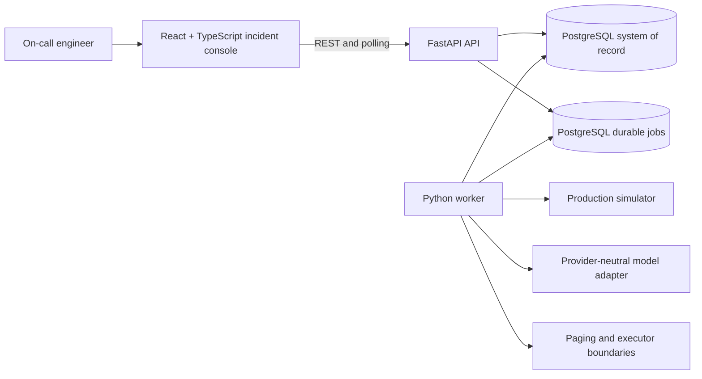

# System Architecture

This high-level architecture describes the runtime boundaries and the executable PostgreSQL schema used by the product.

## 1. Runtime architecture

## 2. Responsibility boundaries

| Component | Owns | Does not own |
| --- | --- | --- |
| React + TypeScript UI | Incident list, detail, timeline, evidence review, and human decision forms | State transitions, action execution, inferred completion |
| FastAPI API | Validation, idempotency, state transitions, read models, and audit events | Long-running investigation or direct model execution |
| Python worker | Investigation jobs, action execution, verification, retries, leases, and overdue-page recovery | Browser presentation or unvalidated human intent |
| PostgreSQL | Incidents, alerts, evidence, findings, pages, actions, jobs, attempts, verifications, and timeline history | External alert generation or model reasoning |
| Production simulator | Deterministic alerts, evidence sources, typed actions, and failure controls | Production credentials or arbitrary command execution |
| Model and delivery boundaries | Structured analysis, optional delivery, ownership, and reconciliation | Direct authorization or incident truth |

## 3. Relational schema catalog

All identifiers are UUIDs unless stated otherwise. JSON fields contain validated data and never executable instructions.

| Table | Fields and constraints |
| --- | --- |
| `incidents` | `id` PK, `fingerprint` UNIQUE NOT NULL, `service`, `severity`, `status`, `summary` NOT NULL, `version` NOT NULL, `created_at`, `updated_at` |
| `alerts` | `id` PK, `incident_id` FK, `source_event_id` UNIQUE NOT NULL, `fingerprint`, `source`, `service`, `severity`, `alert_type`, `labels` JSONB, `description`, `lifecycle`, `source_time`, `received_time`, `raw_payload` JSONB |
| `investigations` | `id` PK, `incident_id` FK UNIQUE, `scenario_id`, `generated_at`, `model_status`, `model_error`, `model_analysis` JSONB, `prompt_version` |
| `investigation_evidence` | `(investigation_id, id)` PK/FK, `source_type`, `query`, `parameters` JSONB, `availability`, `observed_at`, `collected_at`, `duration_ms`, `error`, `items` JSONB |
| `investigation_findings` | `(investigation_id, id)` PK/FK, `category`, `statement`, `confidence`, `suggested_next_step`, `evidence_ids` JSONB, `uncertainty` |
| `pages` | `id` PK, `incident_id` FK, `(incident_id, level)` UNIQUE, `responder`, `fallback_responder`, `status`, `deadline_at`, `response_type`, `response_text`, `incident_version`, `created_at`, `updated_at` |
| `action_proposals` | `id` PK, `incident_id` FK, `scenario_id`, `action_type`, `target`, `parameters` JSONB, `status`, `approval_expires_at`, `approved_by`, `idempotency_key` UNIQUE, `simulator_action_id`, `result` JSONB, `incident_version`, `created_at`, `updated_at` |
| `action_attempts` | `id` PK, `action_proposal_id` FK, `(action_proposal_id, attempt_number)` UNIQUE, `status`, `simulator_action_id`, `result` JSONB, `started_at`, `completed_at` |
| `verifications` | `id` PK, `action_attempt_id` FK, `status`, `observed_state` JSONB, `verified_at` |
| `jobs` | `id` PK, `incident_id` FK nullable, `job_type`, `status`, `payload` JSONB, `idempotency_key` UNIQUE, `attempts`, `max_attempts`, `available_at`, `lease_until`, `last_error`, `created_at`, `updated_at` |
| `page_delivery_attempts` | `id` PK, `page_id` FK, `(page_id, attempt_number)` UNIQUE, `status`, `external_id`, `created_at` |
| `timeline_events` | `id` PK, `incident_id` FK, `event_type`, `event_time`, `received_time`, `(incident_id, sequence_number)` UNIQUE, `payload` JSONB |

## 4. Integrity rules

- Every alert has a source idempotency key and preserved validated payload.
- Every evidence item retains its query, parameters, result, availability, timing, and failure state.
- Every action is typed, linked to an incident, and blocked until explicit approval exists.
- Every action attempt has an outcome and a separate verification record; a timeout never implies success.
- Every durable job has a lease, retry count, and idempotency key.
- Every user-visible state change emits an incident-local timeline event.
- Validated model output cannot execute an action or mutate incident state directly.
