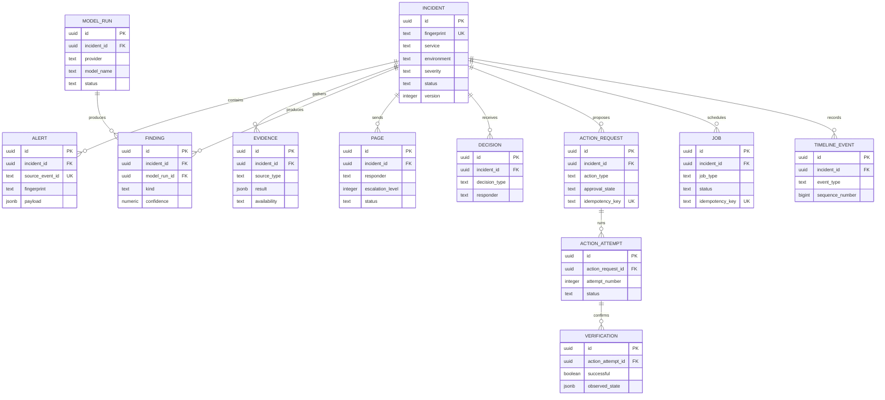

# Domain Data Model

This document shows the durable relationships between the incident workflow entities. Field-level definitions live in the system architecture document.

## Relationship rules

- An incident is the aggregate root for alerts, evidence, findings, pages, decisions, actions, jobs, and timeline events.
- A model run may produce multiple findings, while each finding remains attached to the incident that supplied its evidence.
- An action request may have multiple attempts, but verification belongs to a specific attempt.
- Timeline events provide the user-facing audit sequence without replacing the normalized source tables.
