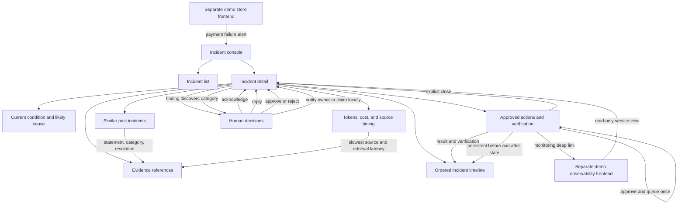

# Main UI Architecture

This document describes the main incident-console structure. It focuses on user-visible composition and interaction boundaries, not backend execution order.

The console implementation lives in `main-app/frontend/`; the API and worker it calls live in `main-app/backend/`.

## UI data boundaries

| UI area | Reads | Writes |
| --- | --- | --- |
| Incident list | Incident summary, severity, status, updated time | None |
| Incident detail | Summary, evidence, findings, pages, decisions, actions, timeline | Acknowledge, reply, approve, reject, close |
| Timeline | Ordered display-safe timeline events | None |
| Similar past incidents | Ranked historical statements, categories, resolutions, and availability | None |
| Evidence telemetry | Prompt/completion token estimates, estimated cost, source durations, retrieval latency | None |
| Action panel | Typed action request, approval state, attempts, verification | Approval or rejection only |
| Demo store | Catalog, cart, synthetic payment fields, payment result | Store payment API only |

## UI rules

- Every user action shows its backend result and the next state returned by the API.
- Evidence is displayed with its source, query, availability, observation time, and relationship to the finding.
- The finding category and recommended action appear only after investigation completes; scenario metadata does not predeclare them in the public workflow.
- Similar-history context is visibly separate from deterministic diagnosis and degrades to an uncertainty note when unavailable.
- Telemetry is compact and bounded: prompt tokens, completion tokens, estimated cost, slowest source, and retrieval latency.
- Approval controls show the exact action type, target, parameters, and expiry before submission.
- Action completion is shown only after simulator execution and verification are persisted.
- Polling refreshes the incident detail and timeline without clearing the selected incident's open sandbox preview.
- Verification shows before/after evidence and a direct incident link; the operator closes the incident explicitly.
- Approval queues the typed action once; verification confirms the observed state but does not close the incident automatically.
- A failed synthetic checkout links directly to its accepted incident; the separate store backend strips payment fields before emitting the operational alert.
