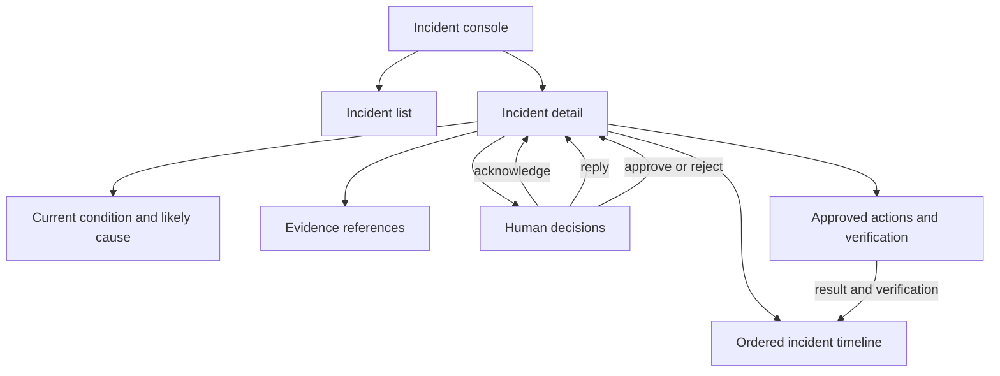

# Main UI Architecture

This document describes the main incident-console structure. It focuses on user-visible composition and interaction boundaries, not backend execution order.

## UI data boundaries

| UI area | Reads | Writes |
| --- | --- | --- |
| Incident list | Incident summary, severity, status, updated time | None |
| Incident detail | Summary, evidence, findings, pages, decisions, actions, timeline | Acknowledge, reply, approve, reject |
| Timeline | Ordered display-safe timeline events | None |
| Action panel | Typed action request, approval state, attempts, verification | Approval or rejection only |

## UI rules

- Every user action shows its backend result and the next state returned by the API.
- Evidence is displayed with its source, query, availability, observation time, and relationship to the finding.
- Approval controls show the exact action type, target, parameters, and expiry before submission.
- Action completion is shown only after simulator verification is persisted.
- Polling refreshes the incident detail and timeline without reordering already persisted events.
