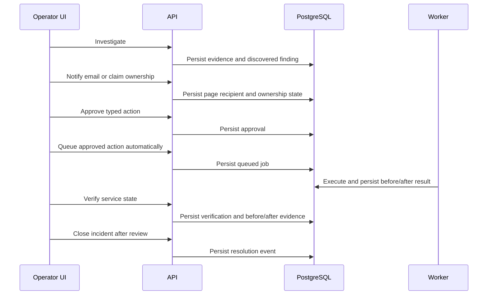

# Paging, Decisions, and Action Classes

## Classes

| Class | Responsibility | Main methods |
| --- | --- | --- |
| `PagingService` | Send pages, track escalation, and record responses | `page()`, `acknowledge()`, `reply()`, `escalate()` |
| `PagingGateway` | Interface for HTTP or SMTP page delivery | `send_page()` |
| `DecisionService` | Validate and persist human decisions | `acknowledge()`, `approve()`, `reject()` |
| `ActionRequest` | Represent a typed requested operation and approval state | `approve()`, `reject()`, `expire()` |
| `ActionService` | Create approved work and expose action state | `request()`, `approve()`, `reject()`, `get_status()` |
| `ActionExecutor` | Interface for typed simulator operations | `execute()` |
| `SimulatorActionExecutor` | Execute allowed operations in the simulator | `execute()` |
| `ActionRepository` | Persist requests, attempts, and outcomes | `save_request()`, `save_attempt()`, `get_status()` |
| `ActionHandler` | Execute an approved action job | `handle(job)` |

## Connections

`DecisionService` changes `ActionRequest` only after validating the responder and approval state. A page request either delivers to a validated recipient or creates an acknowledged local ownership claim. `ActionService` enqueues durable work after the browser records approval. `ActionHandler` calls `ActionExecutor`, persists the attempt, and schedules verification. No API handler calls the simulator directly.

