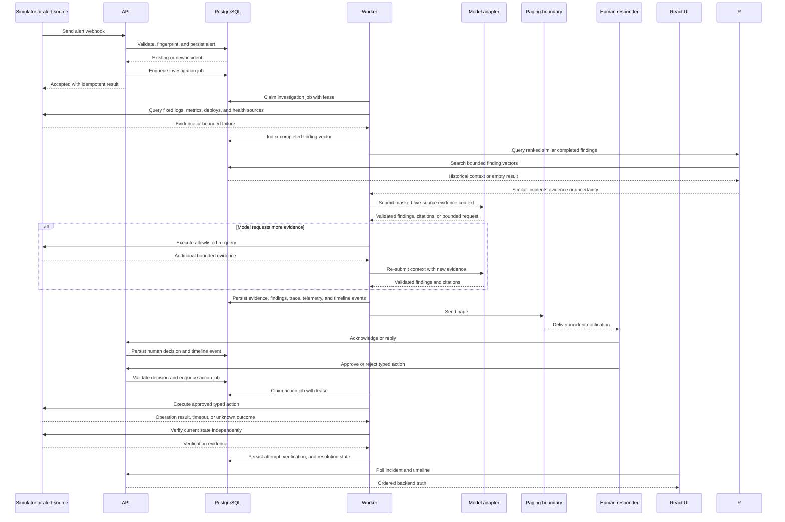

# Runtime Sequence Flow

This document describes the alert-to-resolution runtime sequence. It is intentionally separate from the high-level system architecture because it shows message order, retries, human decisions, action execution, and verification.

## Runtime guarantees

- Duplicate, late, and out-of-order alerts are accepted safely through source keys, fingerprints, and event ordering.
- A synthetic checkout failure uses the same alert webhook and keeps payment fields outside the incident boundary.
- A slow or unavailable evidence source produces a bounded evidence state rather than an invented result.
- Historical retrieval is optional context; empty, slow, or failed retrieval becomes an uncertainty note only.
- The model loop ends on its round, request, evidence-item, or wall-clock bound and records the stop reason instead of raising.
- Source timings, retrieval latency, token estimates, and estimated cost are persisted with the investigation.
- A human approval is checked again when the worker claims the action job.
- An action timeout leads to verification before any success or resolution state is recorded.
- The UI reads the durable incident state and timeline; it does not treat an optimistic request as completed work.
