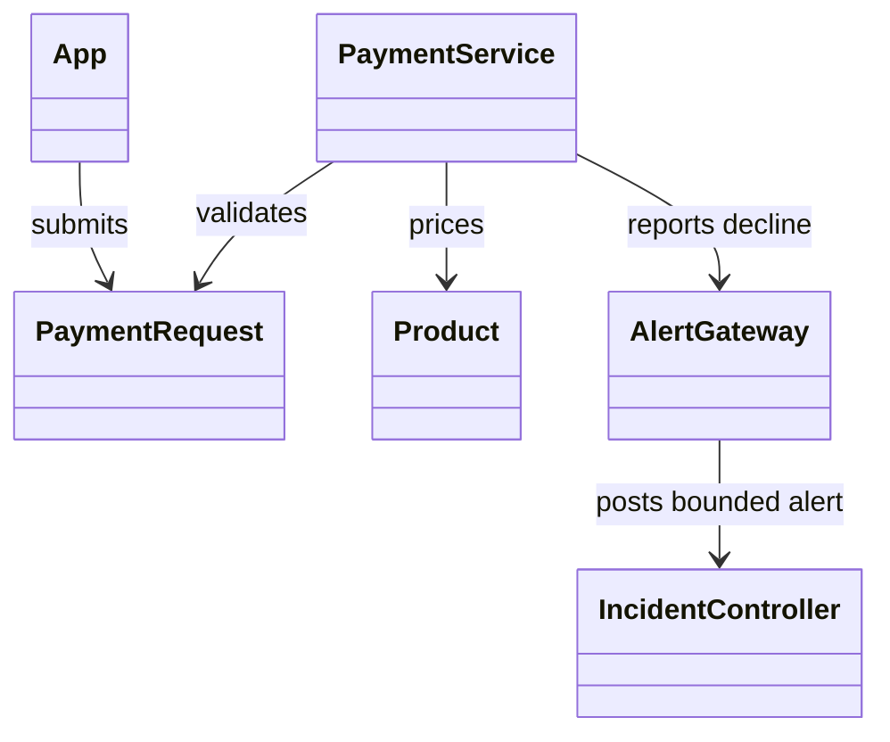

# Demo Store Classes

## Classes

| Class | Variables | Methods | Responsibility |
| --- | --- | --- | --- |
| `Product` | `id`, `name`, `description`, `price_cents`, `tone` | None | Immutable catalog item |
| `PaymentRequest` | `attempt_id`, `product_ids`, `cardholder`, `card_number`, `expiry`, `security_code` | Request-model validation | Validate the synthetic checkout boundary |
| `PaymentService` | `alert_gateway` | `pay(payment)` | Price known products, choose the deterministic result, and emit a bounded failure alert |
| `AlertGateway` | None | `create_incident(payload)` | Submit the operational alert and return the accepted incident identifier |
| `App` | Catalog, cart, checkout, pending result, error | `pay()`, `addProduct()`, `removeProduct()`, `reset()` | Guide the customer-facing demonstration |

## Relationships

The store is intentionally stateless. Approved payments return a synthetic order identifier. Declined payments return the incident identifier created by the existing alert pipeline.
