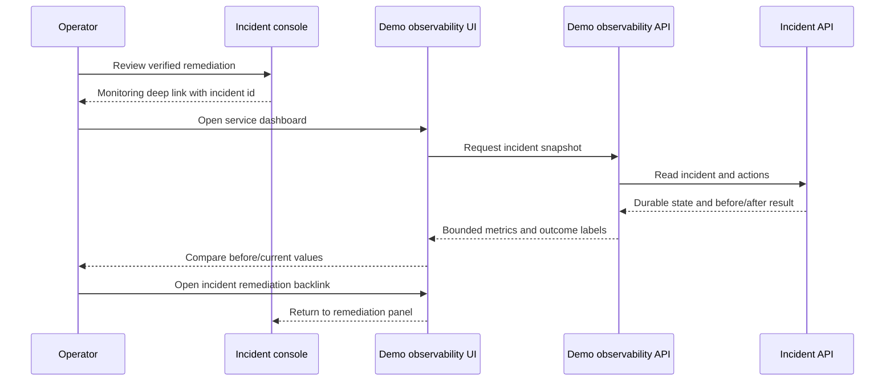

# Demo Observability Classes and Runtime

## Classes

| Class | Responsibility | Main methods |
| --- | --- | --- |
| `ObservabilityBackend` | Map known local services to bounded dashboard profiles and read incident/action state | `dashboard_catalog()`, `incident_snapshot()` |
| `DashboardProfile` | Define labels, targets, trend points, and before/after values for one demo service | data only |
| `ObservabilityFrontend` | Render metric cards, change comparison, action status, and navigation links | `load_snapshot()`, `render_dashboard()` |

## Runtime sequence

The page is intentionally read-only. It demonstrates feasibility for service monitoring and remediation impact while leaving incident truth, action authorization, and persistence in the existing system.
